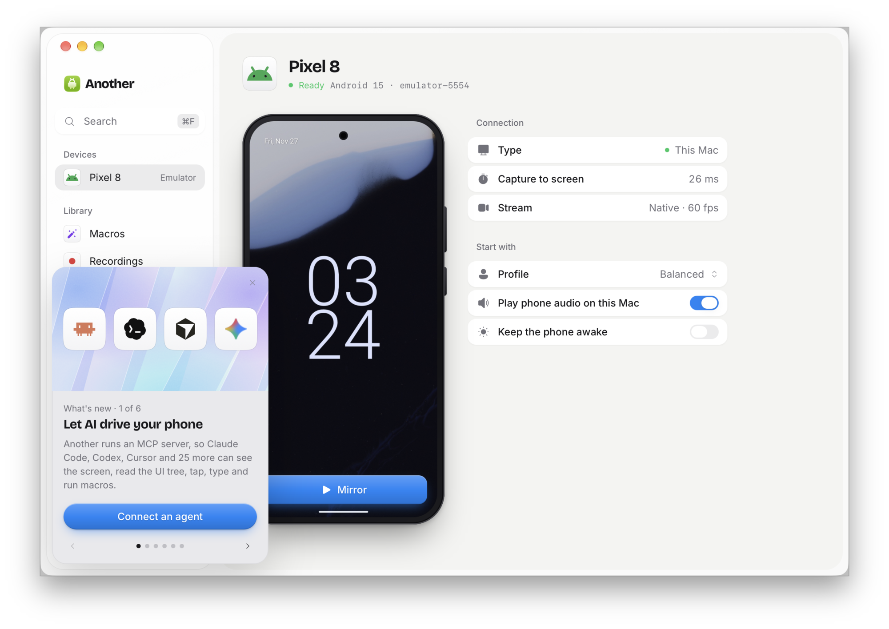

<p align="center">
  
</p>

<h1 align="center">Another</h1>

<p align="center">
  <a href="https://github.com/Zfinix/another/releases/latest"></a>
  <a href="https://github.com/Zfinix/another/releases"></a>
  <a href="https://github.com/Zfinix/another/blob/main/LICENSE"></a>
  <a href="https://glama.ai/mcp/servers/Zfinix/another"></a>
</p>

Mirror and control your Android phones from your Mac. AI agents can drive them through a built-in MCP server, and scripts through the `another` command. Free and open source, built with Tauri and Rust.



## Download

**[Download the latest release](https://github.com/Zfinix/another/releases/latest)**

Or install the app and the `another` command from the Terminal (macOS and Linux):

```sh
curl -fsSL https://raw.githubusercontent.com/Zfinix/another/main/install.sh | sh
```

| Platform | Download |
|----------|----------|
| macOS (Apple Silicon) | [.dmg](https://github.com/Zfinix/another/releases/latest) |
| macOS (Intel) | [.dmg](https://github.com/Zfinix/another/releases/latest) |
| Linux | [.AppImage / .deb / .rpm](https://github.com/Zfinix/another/releases/latest) |
| Windows | [.msi / .exe](https://github.com/Zfinix/another/releases/latest) |

The Mac app is signed and notarized.

## Features

### Mirroring

- Native VideoToolbox decoding on macOS, 60 fps with about 19 ms of lag
- Several phones at once, each in its own window, with audio following the window you're looking at
- Phones over USB, Wi-Fi, Android Studio emulators and your Tailscale tailnet, all in one sidebar
- Pair over Wi-Fi with a QR code, a six digit code or an address
- See a phone's lock screen, battery, storage, memory and display before you mirror
- Starts on **Best for this phone**: 1920 at the phone's full refresh rate, with adaptive quality on Wi-Fi
- Phone audio on your Mac (Android 11+), screenshots and screen recordings
- Drop an APK on the mirror to install it, or any other file to send it to the phone's Downloads

### Around the phone

- Phone notifications as native macOS notifications, with the app's own icon and Copy code for one-time codes
- Macros that read as plain steps: record, replay, rename, import and export
- A command bar (`⌘K`) and keyboard shortcuts for every action
- A stats overlay with frame rate, lag, decode time, bitrate and dropped frames, plus a touch to screen latency probe
- Profiles you can save, share as a file or open from an `another://` link
- Keep the phone awake while it's plugged in, and keep the mirror on top of other windows

### For agents and scripts

- An MCP server with 24 tools, and the exact setup for 27 agents on the **AI and CLI** page
- The `another` command for scripts and automation

## Speed

Measured with the phone's clock in every frame, so these are real capture to screen times.

| Measure | Before | 1.0 |
|---------|-----|-----|
| Frames per second, scroll test | 4 fps | 55 to 60 fps |
| Lag behind the phone | 4,000 ms | 19 ms average |
| Video at 2400×1080 | 27 fps | 60 fps |
| Rust to screen | 10.5 ms | 4.6 ms |
| App CPU at the same frame rate | 13.5% | 2.7% |
| Wi-Fi, capture to screen | 228 ms | 43 to 52 ms |
| Against scrcpy 5.0.1, median | 2.8 ms behind | 5.5 to 7.3 ms ahead |

Before is Another as it was when the 1.0 work started. The scroll test, video, Rust to screen and CPU rows are from a Pixel emulator. Wi-Fi and the scrcpy race ran on a Pixel 4 XL with release builds.

## Command line

The `another` command talks to the running app. Install it from the **AI and CLI** page or with the install script above.

```sh
another status                       # phones being mirrored and their stream state
another devices                      # phones Another can see
another connect <serial>             # mirror a phone in its own window
another disconnect [serial]          # stop one phone, or all of them
another set max_size=1920 max_fps=60 # change stream settings live
another keys                         # settings that `set` accepts
another stats --seconds 10           # average the live stats
another measure                      # time touch to screen latency
another bench a.json b.json          # apply profiles in turn and compare
another profile export -o mine.json  # save the current setup
another profile link mine.json       # print an another:// link for it
```

## MCP server

The MCP server starts with the app at `http://localhost:7070/mcp` (Streamable HTTP, localhost only). Turn it on or off and change the port on the **AI and CLI** page, which also shows the setup for your agent.

Claude Code:

```sh
claude mcp add --transport http another http://localhost:7070/mcp
```

Most other clients (Cursor, Claude Desktop and others):

```json
{
  "mcpServers": {
    "another": {
      "type": "http",
      "url": "http://localhost:7070/mcp"
    }
  }
}
```

**Stdio mode**, for clients that only run local commands:

```json
{
  "mcpServers": {
    "another": {
      "command": "another-mcp",
      "args": ["--scrcpy-server", "/path/to/scrcpy-server-v2.7"]
    }
  }
}
```

### Agent skill

Install the [Another skill](https://clawhub.ai/zfinix/another) to teach your agent how to use the tools:

```sh
npx skills add Zfinix/another@another-android
```

### Tools

| Tool | What it does |
|------|--------------|
| `another_list_devices` | List connected Android devices |
| `another_connect_device` | Connect to a device for control |
| `another_disconnect_device` | Disconnect from the current device |
| `another_take_screenshot` | Capture the screen as a PNG |
| `another_get_ui_tree` | Read the accessibility tree of the current screen, with normalized coordinates |
| `another_find_on_screen` | Find elements by text, content description, resource ID or class, ready to tap |
| `another_send_touch` | Touch down, move or up at screen coordinates |
| `another_swipe` | Swipe between two points |
| `another_send_scroll` | Scroll at screen coordinates |
| `another_send_text` | Type text |
| `another_press_button` | Press home, back, recents, power or volume |
| `another_rotate_device` | Rotate the screen |
| `another_launch_app` | Launch an app by package name |
| `another_open_url` | Open a URL, in Chrome by default (`use_system_handler` for the system chooser) |
| `another_shell` | Run an adb shell command |
| `another_wifi_enable` | Turn on Wi-Fi debugging for a USB phone and connect wirelessly |
| `another_wifi_connect` | Connect to a phone by IP address |
| `another_wifi_disconnect` | Disconnect a Wi-Fi phone |
| `another_get_device_ip` | Get a USB phone's Wi-Fi IP address |
| `another_macro_record` | Start recording a macro |
| `another_macro_stop` | Stop recording and save the macro |
| `another_macro_play` | Play a macro, optionally on repeat |
| `another_macro_list` | List macros |
| `another_macro_delete` | Delete a macro |

## Keyboard shortcuts

**Main window**

| Shortcut | Action |
|----------|--------|
| `⌘K` | Command bar |
| `⌘↩` | Mirror the selected phone |
| `⌘I` | Show or hide stream stats |
| `⌘,` | Settings |
| `⌘T` | Change the theme |
| `⇧⌘T` | Keep on top of other windows |
| `⇧⌘U` | Check for updates |
| `⇧⌘M` | Record a macro |
| `⇧⌘L` | Open macros |
| `⇧⌘I` | Import macros |
| `⇧⌘E` | Export all macros |

**Mirror window**

| Shortcut | Action |
|----------|--------|
| `⌘H` | Home |
| `⌘B` | Back |
| `⌘R` | Rotate the screen |
| `⌘P` | Power |
| `⌘+` / `⌘-` | Volume up / down |
| `⌘M` | Mute or unmute the phone |
| `⇧⌘S` | Take a screenshot |
| `⇧⌘R` | Start or stop recording |
| `⇧⌘M` | Record or stop a macro |
| `⌘I` | Show or hide stream stats |
| `⌘D` | Disconnect |

> On Windows and Linux, use `Ctrl` instead of `⌘`.

## How it works

Another runs its own capture server on the phone, a small Kotlin server started with `app_process`. It drops stale frames instead of queueing them and changes bitrate, size and frame rate without reconnecting. The bundled [scrcpy-server](https://github.com/Genymobile/scrcpy) 2.7 is still available as a fallback in Developer settings.

On macOS, frames are decoded with VideoToolbox onto a native layer behind the window. Elsewhere they reach the web view as raw bytes over a local WebSocket. Over Wi-Fi and Tailscale the stream skips the adb tunnel and uses its own socket.

## Platform support

| Platform | Status |
|----------|--------|
| macOS | Supported |
| Linux | Experimental, no native video |
| Windows | Experimental, no native video |

## Prerequisites

- An Android phone with USB debugging on (or Wireless debugging)
- To build from source: [Rust](https://www.rust-lang.org/tools/install), [Node.js](https://nodejs.org/) and [Bun](https://bun.sh/)

## Development

```sh
bun install
bun tauri dev
```

The phone server is prebuilt in `src-tauri/resources/another-server`. To rebuild it you need Android Studio's Kotlin compiler and the Android SDK:

```sh
bash server/build.sh
```

#### Ubuntu and Debian (including WSL)

```sh
sudo apt update
sudo apt install libwebkit2gtk-4.1-dev pkg-config libasound2-dev
```

## Build

```sh
bun tauri build
```

## Tech stack

- **App:** React 19, TypeScript, Vite, Base UI, Tauri 2
- **Core:** Rust, Tokio, rodio, VideoToolbox on macOS
- **Phone:** the Another server (Kotlin) or scrcpy-server 2.7, over adb or a direct socket
- **Agents:** an MCP server built on rmcp, and the `another` CLI
